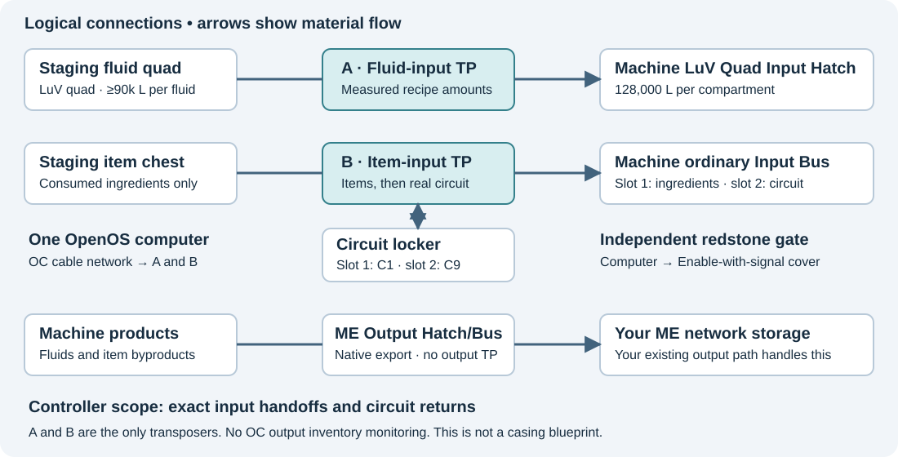

# Dissolution Tank automation with OpenComputers

**GTNH 2.9 · all 33 recipes · two transposers · native ME outputs · reusable circuits**<br>
Prepared 1 November 2026. Native ME export and prefilled GTNH 2.9 material identities are the defaults.

This system watches a staging chest and staging fluid buffer, recognizes a complete recipe, and loads exactly one input batch into the Dissolution Tank. It verifies both fluid quantities before loading consumed items, inserts a required programmed circuit last, then allows the machine to start. Once those inputs are consumed, it returns the same circuit to its locker and can prepare the next batch.

**Your normal output path handles the products:** an ME Output Hatch for fluids and an ME Output Bus, or your existing item export path, for item byproducts. The default controller has no output transposers, output addresses, product buffers, or output-inventory polling. It tracks input acceptance, not finished production or delivery to ME.

**No ingredient samples are required to register the recipes.** The supplied material profile includes all nine item identities and eleven fluid names, checked against loaded-pack registry data. Commission recipes as you acquire their ingredients.

The catalog contains **33 recipes: 9 processing recipes and 24 flora conversions**. Inputs were cross-checked against GTNH sources and 33 unique entries in the available archived recipe dump. Simulated tests exercise all recipes in both the new external-output mode and the optional original managed-output mode. **This has not been run inside Minecraft.** Compare the reference with NEI on your pack/server build and complete the live commissioning steps.

[TOC]

## 1. What you are building

There are two layers of input storage:

* **Staging:** a chest and separate multi-fluid buffer, supplied manually or by AE2. Together they hold a complete recipe lot, from which the program identifies the recipe.
* **Machine inputs:** an ordinary Input Bus and a LuV Quad Input Hatch installed in the multiblock. Only this controller loads them; they hold one exact pending batch.

A separate circuit locker contains one real circuit programmed to **1** and one programmed to **9**. These are tools, not staged ingredients. Two OC transposers serve the fluid inputs and item/circuit inputs. Your existing ME export arrangement remains responsible for products.



The diagram shows adjacency and ownership, not a casing blueprint. Build the tank with its normal structure hints/projector. Place its Input Hatch and Input Bus so their transposers can touch accessible faces. OC cables connect both transposers to the computer but do not carry materials or extend adjacency.

### The operating sequence

| Phase | Action | Start permission |
|---|---|---|
| Idle | Require empty machine inputs; recognize a complete staged lot | Off |
| Fluids | Move measured amounts; reread actual hatch contents after each transfer | Off |
| Items | Verify exact fluids, then load consumed ingredients | Off |
| Circuit | Move one required circuit from locker to an ordinary bus slot | Off |
| Armed | Verify the entire batch, then allow the machine to accept it | On |
| Return | Once both fluids and consumed items disappear, remove start permission and return the circuit | Off |
| Ready | Clear that input transaction and prepare another staged lot | Off until the next exact batch is ready |

“Accepted” means the ingredients were consumed at recipe start. It does **not** mean the products have finished. The running recipe already has its outputs and duration recorded, so its bus circuit can return while it processes. A following batch can be loaded with start permission off, then wait fully assembled until the machine is available. The [multiblock implementation](https://github.com/GTNewHorizons/GT5-Unofficial/blob/master/src/main/java/gregtech/api/metatileentity/implementations/MTEMultiBlockBase.java) consumes inputs at the recipe check and records the running work; new starts still depend on its allowed-to-work state.

No ingredients for a third batch enter the actual machine while a second batch is waiting there. The program waits for the pending batch's consumption before reusing its input inventories. The [tank's ratio check](https://github.com/GTNewHorizons/GT5-Unofficial/blob/master/src/main/java/gtnhlanth/common/tileentity/MTEDissolutionTank.java) runs when a recipe starts, which is why exact quantities and the independent start gate matter.

## 2. Parts and capacities

| Quantity | Part | Requirement / reason |
|---:|---|---|
| 1 | Complete Dissolution Tank | Correct structure, maintenance, and power |
| 1 | IV-capable energy supply and suitable energy hatch | Highest base recipe demand is 7,680 EU/t; account for actual voltage/amperage and overclocking |
| 1 | **LuV Quad Input Hatch** in the machine | Four 128,000 L compartments; largest single input is 90,000 L |
| 1 | Separate LuV Quad or equivalent staging tank | At least two independently readable/selectable compartments, large enough for the staged lot |
| 1 | Ordinary LV Input Bus or larger | At least two accessible ordinary slots: consumed slot 1, circuit slot 2 |
| 2 | OC transposers | One fluid input, one item/circuit input |
| 1 | OpenOS computer with redstone card | Sufficient CPU component budget, RAM, HDD, OC power, GPU/screen and keyboard for your setup |
| As needed | OC cables | Connect both transposers and computer |
| 1 each | Staging chest and circuit-locker chest | Ordinary inspectable inventories |
| 1 | Machine Controller cover and redstone connection | **Enable with signal** |
| 1 each | Real integrated circuits 1 and 9 | Exactly one in each reserved locker slot |
| Your normal setup | ME fluid Output Hatch and item Output Bus/export path | Products export independently; keep ME connected and supplied with storage |
| Optional | Chunk loading | Load computer, machine, staging, and ME export components together |

**An IV Quad Input Hatch is too small for all recipes:** it has 64,000 L per compartment. A LuV Quad has 128,000 L per compartment. Do not confuse an ordinary hatch's capacity with the per-compartment capacity of a quad. See the [multi-input hatch implementation](https://github.com/GTNewHorizons/GT5-Unofficial/blob/master/src/main/java/gregtech/api/metatileentity/implementations/MTEHatchMultiInput.java).

An unattached quad can serve as the staging reservoir in the checked implementation. Verify filling and extraction on the faces you use, including reverse extraction for the probe. Another multi-tank inventory is suitable if OC can inspect and select each source compartment. A pipe network is a poor staging store because its visible contents can change with flow.

The supplied input driver expects **one machine fluid input block exposing at least two compartments**. Two separate ordinary input hatches require a different driver.

### Native output setup

Connect the machine's fluid ME Output Hatch to your ME network. Use an ME Output Bus or your usual automatic item output path for byproducts. No OC transposer needs to touch either output. Chance-based byproducts may be absent; the feeder does not wait for them.

The largest guaranteed fluid product is **99,000 L**. Ensure the native output path and storage can accept it, and enable the machine's item/fluid void protection. Verify behavior with the ME network disconnected or full during commissioning. The feeder does not inspect output capacity, connectivity, buffers, or successful delivery. Native output buffering may allow a batch to start even while ME is unavailable; input consumption is not a delivery receipt.

There is no requirement for an ordinary 99,000 L machine output hatch in this default mode. That was needed by the optional output-measuring arrangement. Your ME hatch handles its own buffering/export behavior.

## 3. Build and wire it

### A. Machine settings

1. Build and maintain the tank with its normal structure. Install its ME outputs and connect them normally.
2. Disable batch mode, input separation, and recipe locking for this dynamically changing single-input-batch design. Enable item/fluid void protection.
3. Clear the controller's internal circuit setting and the Input Bus's dedicated circuit setting/ghost slot.
4. Empty every ordinary input slot and all machine input-fluid compartments. Outputs may be handled by their normal export path.
5. Disable bus sorting. Reserve **ordinary Input Bus slot 1** for consumed ingredients and **ordinary slot 2** for the real circuit. Leave all other bus slots empty.
6. Disconnect other automated feeds from the actual machine inputs. AE2 delivers ingredients to staging only. Its native output connections stay in place.

The dedicated circuit slot blocks normal automated insertion/extraction in the [Input Bus implementation](https://github.com/GTNewHorizons/GT5-Unofficial/blob/master/src/main/java/gregtech/api/metatileentity/implementations/MTEHatchInputBus.java). This design uses a real item in an **ordinary** slot instead. On a normal LV bus the virtual/dedicated slot follows four ordinary slots and may appear as OC slot 5. Inspect the GUI as well as `scan`; a virtual setting may not behave like a normal stack.

### B. Two transposer connections

| Config role | Adjacent endpoints | Example directions from that transposer |
|---|---|---|
| `inputFluids` | Staging fluid quad; actual machine Quad Input Hatch | Stage above; machine north |
| `inputItems` | Staging chest; actual Input Bus; circuit-locker chest | Stage above; bus north; locker west |

Change these example directions to your physical build. They are absolute world directions **from each transposer**: `north`, `south`, `east`, `west`, `up`, `down`. Point hatch/bus access faces toward the transposers and configure covers to permit the required transfers.

### C. Independent start gate

Install a Machine Controller cover and select **Enable with signal**. Run a separate redstone connection from the computer's redstone output to that cover. A redstone card uses directions **relative to the computer's front**. Prefer `front`, `back`, `left`, `right`, `up`, or `down` for `redstone.side`. Its aliases `east`, `west`, `north`, and `south` mean left, right, back, and front respectively; they do not necessarily match world compass directions. See the [OC redstone API](https://ocdoc.cil.li/component:redstone). Transposer directions use world axes.

Example: if the computer's front faces world east and the output wire is on world east, use **`side='front'`**. The default `side='east'` means the computer's left, which in that orientation is world north.

Choose the side before running a transaction. If a batch is already waiting armed, configuration changes invalidate its resume signature. To finish that job, route the currently configured physical output to the cover. Wait for **“Input batch accepted; ready for next staged lot”**, which follows clearing the journal. Then stop the loop and change the configured side/wiring for future jobs.

Signal 15 must permit new recipes, and signal 0 must prevent them. A batch already processing is allowed to finish while permission is off. Prove the polarity in the GUI before production. Start with the cover's ordinary enable mode. If you choose its optional safe mode, account for its critical-failure latch and manual reset behavior; see the [cover implementation](https://github.com/GTNewHorizons/GT5-Unofficial/blob/master/src/main/java/gregtech/common/covers/CoverControlsWork.java).

### D. Circuit locker

Put exactly **one circuit programmed to 1 in locker slot 1** and **one circuit programmed to 9 in locker slot 2**. Reserve those slots. The program never manufactures, reprograms, or consumes the circuits.

For a circuit recipe it moves the required circuit to ordinary bus slot 2 after fluids and consumed items are correct. Once the consumed ingredients disappear, the circuit returns immediately to its home slot; it does not wait for processing or ME delivery. Circuit-free recipes leave both circuits home. A following recipe can reuse a returned circuit while the previous recipe is still running.

## 4. Install the program

### Download with an Internet Card

With OpenOS installed on the hard drive, insert an Internet Card into a Tier 2 or higher card slot and run:

```sh
wget -f https://raw.githubusercontent.com/dronf/gtnh-dissolution-tank-oc/main/install.lua /tmp/dt-install.lua && lua /tmp/dt-install.lua
```

The installer puts all six runtime files in `/home/dissolution`. It uses a pinned tested revision, checks file sizes and Lua syntax, and stages every file before committing the new directory. If a download fails, it removes its partial staging files. It refuses to overwrite any existing destination. To install another copy, use a new directory: `lua /tmp/dt-install.lua /home/dissolution-new`.

HTTP access must be enabled by the server. The [Internet Card](https://ocdoc.cil.li/item:internet_card) is required only while downloading; the controller runs without one afterward. The full offline guide is meant for your normal browser, while the installer copies just the runtime files.

Then follow the component-address, material-profile, and commissioning steps below. For your top-mounted transposer layout, use `stageSide='up'` and `machineSide='down'` for both input roles, and the actual compass direction for `lockerSide`.

### Manual copy alternative

Extract the package on your PC. Copy these **six files together** into an OpenOS directory such as `/home/dissolution`:

```
dt.lua
dt_core.lua
dt_io.lua
dt_bindings.lua
recipes.lua
config.lua
```

Use your usual OC file transfer method: an in-game editor with clipboard access, your own hosted downloads, or administrator access to a directory-backed OC disk while the server is stopped. HDD storage formats vary; do not edit raw disk/NBT data assuming it is a normal folder. Copying these files to the Minecraft client's mods folder does not install them on a multiplayer server's OC computer.

In OpenOS:

```sh
cd /home/dissolution
lua dt.lua help
lua dt.lua components
edit config.lua
```

Replace the two transposer addresses and redstone address with their full component UUIDs. Identify which is which by physical labeling and component inspection; the listing does not know your plumbing roles. Set all directions and locker/bus slots to match your build.

`components` can run before `config.lua` is configured or even present. Other commands resolve their companion files beside `dt.lua`, including when launched through OpenOS with `lua dt.lua ...`.

Keep these defaults initially:

```lua
outputMode='external',
consumedSlot=1, circuitSlot=2,
circuitLockerSlots={[1]=1,[9]=2},
maxEUt=7680,
preferCircuit=9,
onlyRecipe=nil,
sourceTankBase=0,
fluidChunk=1000, itemChunk=64,
pollSeconds=0.25, jobTimeoutSeconds=1800,
commissioningPassed=false
```

`maxEUt` is a catalog filter and a declared capability, not a reading from the energy hatch. It cannot prove that you have power, maintenance, correct voltage, or enough amperage. All-33 startup checks require it to be at least 7,680.

`fluidChunk` is a maximum request, not an assumed delivered amount. A transposer may deliver less, or nothing. The next step rereads the real hatch. OC transfer limits and server settings affect speed; increase the job timeout if legitimate loading plus processing takes longer than 30 minutes. Larger requests do not bypass the OC transfer rate.

With `outputMode='external'`, no `outputFluids` or `outputItems` entry is required. The default config comments out the old optional entries. Missing output hardware is expected in this mode.

If updating an earlier copy, finish or manually reconcile its old transaction before replacing files or changing modes. Keep an unfinished job's exact original configuration, bindings, and catalog for recovery; do not change its mode mid-job.

## 5. Use the prefilled material identities

All **nine item types and eleven fluid types** are already defined in `dt_bindings.lua`, using the registry names and metadata checked for GTNH 2.9. You do not need to collect rare flowers, saplings, fluids, or other ingredients as samples. All 33 recipes have identities immediately, including recipes whose ingredients you do not yet own.

```sh
lua dt.lua materials
```

This command lists effective IDs, labels defaults versus local overrides, and reports **33 / 33** identities. It works before component addresses are configured and moves nothing. The profile and evidence are documented in [REGISTRY.md](REGISTRY.md).

Existing values in `bindings.dat` override the defaults. There is no automatic reset of earlier manual bindings. New binding commands save just local overrides. Keep the same profile, saved bindings, catalog, and configuration throughout an unfinished transaction; finish/reconcile an old job before upgrading these files.

Configure the transposer/redstone addresses and directions, place the real circuits in their reserved locker slots, then run:

```sh
lua dt.lua scan
lua dt.lua check
```

These are **hardware checks**, not a requirement to sample every ingredient. The scan should show the input, staging, and locker inventories and each input tank's capacity. The default profile supplies identities even if staging is completely empty. `check` verifies the input capacity and both locker circuits. It does not prove the recipe inputs are present or that all recipes have been live-tested.

The program still inspects actual staged and machine contents during operation to measure transfers. Inspection must be enabled on the server. For tagged stacks, visible NBT is required; normal profile ingredients are untagged. Do not conflate different tagged items by hiding their NBT.

### Optional item overrides

Skip the following sampling tables for a standard matching GTNH 2.9 setup. Use them only if an actual server-specific registry or NBT difference prevents a recipe match.

Place a sample in **staging chest slot 1**, run the corresponding command, then remove it before sampling another material. The slot number can be changed if needed.

| Symbol | Sample to use | Command |
|---|---|---|
| `saltpeter` | Saltpeter dust used in the tank recipe | `lua dt.lua bind-item saltpeter 1` |
| `prismarine_shard` | Correct Prismarine Shard from NEI | `lua dt.lua bind-item prismarine_shard 1` |
| `flower` | Any Botania **Glimmering Flower** | `lua dt.lua bind-item flower 1` |
| `virus` | Botania virus item, metadata 0 | `lua dt.lua bind-item virus 1` |
| `witchery_ingredient` | Witchery ingredient base item; a listed variant is best | `lua dt.lua bind-item witchery_ingredient 1` |
| `golden_oak` | ThaumicBases goldenOakSapling base item, variant 2 or 3 | `lua dt.lua bind-item golden_oak 1` |
| `rainbow_cactus` | ThaumicBases rainbowCactus, metadata 0 | `lua dt.lua bind-item rainbow_cactus 1` |
| `rose_vine` | WitchingGadgets WG_RoseVine, metadata 0 | `lua dt.lua bind-item rose_vine 1` |
| `circuit` | Both real circuits in their assigned locker slots | `lua dt.lua bind-circuits` |

The catalog supplies the required metadata for flora variants and circuit programs. One glimmering-flower sample binds the base item for all 16 colors. **Ordinary mystical flowers or mushrooms are different base items and are not substitutes.** The same rule lets one correct Witchery ingredient base item cover its three listed metadata variants.

### Optional fluid overrides

Put a small amount of the named fluid into the staging quad, scan to find its compartment, and bind it. The example uses readable compartment **1**. Use the actual compartment number shown by `scan`. Remove each sample afterward; sample leftovers otherwise become extra staged ingredients.

| Symbol | Actual material | Command, assuming sample in compartment 1 |
|---|---|---|
| `water` | Water | `lua dt.lua bind-fluid water 1` |
| `monazite_muddy` | Muddy Rare Earth Monazite Solution | `lua dt.lua bind-fluid monazite_muddy 1` |
| `bastnasite_conditioned` | Conditioned Bastnasite Mud | `lua dt.lua bind-fluid bastnasite_conditioned 1` |
| `nitric_acid` | Nitric Acid | `lua dt.lua bind-fluid nitric_acid 1` |
| `samarium_muddy` | Muddy Samarium Rare Earth Solution | `lua dt.lua bind-fluid samarium_muddy 1` |
| `samarium_mud` | Samarium Rare Earth Mud | `lua dt.lua bind-fluid samarium_mud 1` |
| `industrial_hf` | **Industrial Strength Hydrofluoric Acid** | `lua dt.lua bind-fluid industrial_hf 1` |
| `hydrogen_peroxide` | Hydrogen Peroxide | `lua dt.lua bind-fluid hydrogen_peroxide 1` |
| `prismarine_peroxide` | Prismarine-Contaminated Hydrogen Peroxide | `lua dt.lua bind-fluid prismarine_peroxide 1` |
| `purifying_fluid` | Fluid with source registry name `fluidpure`; verify its NEI recipe | `lua dt.lua bind-fluid purifying_fluid 1` |
| `liquid_death` | Liquid Death, source registry name `fluiddeath` | `lua dt.lua bind-fluid liquid_death 1` |

Standard/diluted HF must not be bound as industrial-strength HF. Two distinct aliases in the same recipe must not resolve to the same actual fluid. Labels are for people; matching uses the registry identity learned from the sample.

If you used optional sample overrides, remove those samples and leave both circuits home before checking:

```sh
lua dt.lua check
```

The result must report **33 / 33** recipes with all material bindings. This checks machine input-fluid capacities and both circuits too. It does not inspect outputs in external mode. It does not prove your recipe versions, cover polarity, live transfer access, or power. Back up your configured `config.lua` and any `bindings.dat` created by optional overrides; no binding file is needed to use the defaults.

## 6. Commission it before production

### Test selected-fluid transfers

The selected-tank argument needs special attention. The checked GTNH [transfer implementation](https://github.com/GTNewHorizons/OpenComputers/blob/master/src/main/scala/li/cil/oc/server/component/traits/InventoryTransfer.scala) passes the source tank argument into [FluidUtils](https://github.com/GTNewHorizons/OpenComputers/blob/master/src/main/scala/li/cil/oc/util/FluidUtils.scala) as a raw **zero-based** index. The readable `getFluidInTank` result is a **one-based Lua array**. Other forks/documentation may differ. The supplied driver handles that distinction with `sourceTankBase=0`.

1. Keep `commissioningPassed=false`, the machine start signal off, all machine item slots empty, and the machine fluid input empty. Do not load production items during this test.
2. Stage two **different readily available** fluids in two known compartments; water and lava can be used for this isolated transfer test, without any recipe items. At least one should be in a compartment after the first. Use `scan` to identify their readable compartment numbers.
3. If the second readable compartment contains the intended sample, run:

   ```sh
   lua dt.lua probe 2
   ```

4. The command must transfer exactly **1 L of the selected fluid** into the machine and return it, leaving the machine input empty. Verify the printed identity and scan both blocks. Repeat with another occupied nonfirst compartment if practical.
5. If it moves nothing, inspect faces, covers, and extraction permission first. If it moves the wrong fluid, keep the machine isolated, remove the probe fluid from the machine, and determine your installed API's index convention. Use `sourceTankBase=1` only if that convention is confirmed; repeat the test successfully afterward.

The probe stops on a wrong fluid rather than continuing production. A failed probe may leave its test unit inside the machine. Remove that unit and check the machine is empty before trying again. Do not solve this by adding ingredients or bypassing the gate.

The transposer cannot choose a destination compartment. The quad hatch accepts matching fluid into its matching compartment or uses a free compartment. The controller identifies compartments from their contents, checks totals, and refuses unexpected/excess fluid. It does not assume the two recipe fluids always occupy physical slots 1 and 2.

### Prove the start gate

With the program stopped and no production inputs present, test the redstone line using the OC Lua interpreter or another controlled source. Confirm low signal prevents new starts and high permits them. Return it low. A lit wire alone is insufficient; cover mode, face, and polarity matter.

### Live recipe and queue tests

1. Inspect an idle machine with empty inputs. Run `scan`, `check`, and the successful fluid probe. Remove sample items/fluids from staging. `check` must show **33 / 33** and output mode **external**.
2. Start with a recipe you can actually supply; the following example is `prismarine_fresh`. Compare it against NEI. Stage **24 Prismarine Shards + 4,000 L Industrial Strength HF + 4,000 L Hydrogen Peroxide**. Run `lua dt.lua plan`; it must identify one fresh batch without moving anything.
3. After the wiring/binding checks, set `commissioningPassed=true` in `config.lua`. Run `lua dt.lua run`. Watch exact fluids arrive first, then items, then start permission. Once the tank consumes the batch, the feeder reports an accepted input batch. It need not wait for products to appear.
4. Independently watch the machine finish and confirm **8,000 L Prismarine Solution** and the item byproduct reach ME through your native outputs. A feeder “accepted” message is not proof of that delivery.
5. Stop the waiting loop with Ctrl+C and test `monazite_1`. Confirm circuit 1 leaves locker slot 1, goes to ordinary bus slot 2, and returns after ingredient consumption—even if the tank is still processing.
6. Test circuit 9, then `monazite_9` with its maximum **90,000 L + 9,000 L input / 99,000 L fluid output**. Confirm your input capacity and native output path handle it.
7. Test a samarium circuit-only recipe: empty staging chest plus its two fluids must wait for the program to insert the circuit before starting. Test one fast flora conversion as well.
8. While a long recipe is active, stage a second complete recipe. Watch it load with permission off, reach exact amounts, then wait armed with its required circuit. It must remain in the machine inputs until the running recipe finishes and the next one starts. No partial fluid load should be allowed to start.
9. Test a controlled interruption during input loading and recover with `resume`. Test an interruption after input consumption; the circuit should still return exactly once. In both cases independently verify the actual product, because external mode does not supervise production.
10. Test your native export behavior with ME full/offline, using a recoverable setup. Confirm void protection/buffering work as expected and understand how you restore export. The feeder must not be used to diagnose or certify ME delivery.
11. Commission other recipes **as their ingredients become available**. You do not need to own or test every ingredient before using a recipe you can supply. Keep untested recipes marked as such, and only claim all 33 are live-proven after running each. Set `onlyRecipe=nil` with no unfinished job when ready for automatic recognition.

Tests for recipes you cannot currently supply can wait. Set `onlyRecipe` to a particular recipe ID when removing ambiguity for a test. Edit configuration only when there is no unfinished input transaction. Simulation covers logic and mocked I/O; it cannot validate your physical hatches, actual covers, server settings, or installed recipe changes.

## 7. Recipe recognition and AE2 use

The staging chest and fluid buffer together must contain exactly one recipe's ingredients multiplied by the same whole-number batch count. The program rejects mixed recipes, wrong quantities, unrelated items, and partially delivered lots. It waits without loading the machine until the complete lot matches. The locker is not part of that ingredient comparison.

Examples:

* **24 shards + 4,000 L HF + 4,000 L peroxide:** one fresh-prismarine batch.
* **48 shards + 8,000 L HF + 8,000 L peroxide:** two fresh batches; loaded and completed separately.
* **24 shards + 4,000 L HF + 3,999 L peroxide:** incomplete; nothing loads.
* **24 shards + correct fluids + one spare cobblestone:** no match; nothing loads.
* **1,000 L nitric acid + 1,000 L muddy samarium solution, empty staging chest:** valid circuit-1 leaching recipe. The program supplies the circuit.

The circuit-1 and circuit-9 variants share proportional ingredients. Nine small monazite batches have the same staged amounts as one circuit-9 batch. The default `preferCircuit=9` chooses the large variant when both match. To demand the small variant, set `onlyRecipe='monazite_1'`, or configure the preference appropriately. This is a policy choice; ingredient quantities alone cannot express which of those two you intended.

For AE2, make processing patterns whose destinations are the **staging buffers**. Include consumed ingredients and exact fluids; omit the reusable circuit from the pattern. The program chooses its circuit. Use an appropriate fluid-capable pattern/provider arrangement for your pack, with blocking or equivalent queue isolation, so different recipes do not mix in staging. Verify exact delivered liters with `scan` before unattended crafting.

Configure expected products from NEI. Chance-based samarium byproducts should not be required as guaranteed returns. The controller does not create AE2 patterns, issue crafting requests, or report probabilistic outputs as guaranteed.

After one batch is accepted, the feeder can take the next complete staged lot while the current recipe processes. It fills the actual inputs with exactly one pending batch and waits for its consumption. It does not add further lots to those occupied inputs. Keep different recipes isolated in staging; leftover unrelated fluids prevent a match.

AE2 still observes the actual products through your normal ME output path. The feeder does not generate a false craft-complete acknowledgement when inputs are consumed.

## 8. Input handoff, faults, and recovery

### What is and is not acknowledged

An input transaction finishes when both required fluids and consumed items have disappeared from the actual machine inputs and the reusable circuit is back home. With exclusive ownership of those inputs, this indicates recipe acceptance. Outputs can leave immediately through ME; the program never needs to see them or read an output quantity.

The machine may still be running after its input transaction is erased. If it later loses power, fails, or cannot export, this feeder does not detect finished-product loss or retry the consumed recipe. Use the machine GUI and AE2 crafting status to diagnose production/export. Do not automatically repeat a consumed recipe assuming the output was lost.

### Normal stop and reboot recovery

Ctrl+C stops the loop, attempts to lower the start signal, and retains any unfinished **input** transaction. A running recipe is not cancelled by removing start permission. The journal records the input recipe and phase before transfers; recovery compares actual input contents rather than assuming a previous transfer succeeded.

After an interrupted input job:

1. Inspect machine progress, input contents, circuit locations, and native export status. Stop other feeds touching the actual inputs.
2. Keep the same `config.lua`, `bindings.dat`, and `recipes.lua` used for the job. `resume` rejects a changed signature. Restore originals if edited mid-job.
3. If a stale process lock exists, confirm no other controller process is running, then use `lua dt.lua unlock`. This removes only the process lock.
4. Use `lua dt.lua resume`. If the machine already consumed the job's inputs, it returns the surviving circuit instead of loading the job again. If inputs are still being loaded or waiting, it reconciles them and continues. Watch the recovery.

`run` refuses an existing journal; `resume` requires one. If a job was already accepted and its input transaction cleared, no journal for its ongoing production is expected. After inspecting that state, `run` can prepare another batch while the machine works. It cannot recover or certify the previous batch's products.

The lock prevents ordinary accidental double starts, not multiple independent computers. Use one controller with exclusive ownership of the machine's inputs.

### Fault checklist

| Symptom | Check / action |
|---|---|
| Waiting for a complete recipe | Partial delivery, wrong amounts/base items, missing bindings, sample residue, or mixed staged lots |
| Ambiguous recipes | Choose `preferCircuit` or `onlyRecipe`; do not put a spare circuit in staging |
| Cannot inspect inputs | Component UUIDs, directions, access faces/covers, OC inspection settings |
| Fluid loading stalls | Source quantity, extraction permission, input capacity, successful index probe, OC power |
| Unexpected/excess input fluid | Find residue, another feed, wrong binding, or tank-index mismatch before continuing |
| Bus/circuit slot error | Sorting, other inserters, occupied ordinary slot, virtual circuit settings, incorrect slot numbers |
| Missing circuit / occupied home slot | Locate the real circuit and restore reserved slots without duplicating it |
| Armed with exact inputs, not consumed | Machine may still be busy; otherwise check power, maintenance, structure, redstone polarity, NEI recipe and output protection |
| Feeder accepted, but no product in ME | Inspect the running machine and native output hatch/bus/network; the feeder does not monitor them |
| Signature changed | Restore the original config/bindings/catalog for that unfinished input job |
| Input transaction timeout | Inspect the machine and queued inputs; journal remains. Fix the cause, then `resume` |

No fault path intentionally flushes, voids, or reloads a questionable batch. The default 30-minute timeout covers loading and waiting for input acceptance; it may include time spent waiting for a previous recipe. It does not time the completed production/export of a batch whose inputs were already accepted. Resuming starts a new timeout window. Waiting for a staged recipe can wait indefinitely.

### Manually abandoning an input transaction

1. Visually confirm the machine is **idle**. Empty inputs alone do not prove that: a running recipe has already consumed them.
2. Recover or reconcile all pending ingredients and empty the actual machine inputs.
3. Restore both real circuits to their assigned locker slots.
4. Use `lua dt.lua clear CONFIRM_EMPTY`.

In external mode this checks **input emptiness and circuits**, not output inventories or ME delivery. It cannot independently prove the machine is idle. Leave normally exported products in your ordinary output path. If the journal is missing/corrupt, reconcile any running or queued work before a reset; do not blindly load a replacement for a recipe that may already have started.

### Persistence and power

The program attempts to lower the start signal on startup and controlled exits. A sudden power loss can retain a redstone state. Exact pending-input isolation limits what can start, but software is not a guaranteed electrical cutoff. Keep the computer, machine, and ME network reliably powered and loaded.

Persistent files beside the scripts are `bindings.dat`, `transaction.dat` with backups, and `controller.lock`. Keep the HDD intact and back up configured files while idle. The journal records input handoffs; world backups and physical inspection remain necessary after corruption.

### Optional original managed-output mode

The old four-transposer arrangement remains available for a standalone machine without native export. Set `outputMode='managed'` and supply `outputFluids` and `outputItems` component tables as shown in the comments in `config.lua`. Each table specifies `address`, `machineSide`, and `storeSide`.

That mode requires one ordinary machine Output Hatch holding **at least 99,000 L** (ordinary EV holds 128,000 L), an adequate Output Bus, and the two extra transposers to drain them into external product storage. Only the controller may empty the actual outputs. It waits for the entire expected fluid product, drains fluid/items, then returns the circuit. Mixing immediate ME extraction with that completion method will cause it to miss the product and wait.

For your normal ME output setup, keep **`outputMode='external'`** and omit both output component tables. Never switch modes during an unfinished transaction.

## 9. Complete 33-recipe reference

All fluid quantities are **liters per base recipe**. Times are base durations at 20 ticks/second, before overclocking. EU/t is the recipe's base demand. “Circuit —” means no circuit. Ingredients listed here are consumed; circuits are not.

The symbolic fluid names below are exactly the aliases used by the binding table. Variant metadata is intentional. For untranslated flora names, the source registry item/metadata is given instead of guessing an English label. Match them against NEI.

### Processing recipes (9)

| Recipe ID / operation | Consumed items | Input fluids (L) | Circuit | Guaranteed fluid product | Base time / EU/t |
|---|---|---|---:|---|---|
| `monazite_1`<br>Monazite dilution, circuit 1 | 1 × saltpeter | 10,000 water<br>1,000 monazite_muddy | 1 | 11,000 L Diluted Rare Earth Monazite Mud | 45 s / 480 |
| `monazite_9`<br>Monazite dilution, circuit 9 | 9 × saltpeter | 90,000 water<br>9,000 monazite_muddy | 9 | 99,000 L Diluted Rare Earth Monazite Mud | 405 s / 480 |
| `bastnasite`<br>Bastnasite dilution | 1 × saltpeter | 10,000 water<br>1,000 bastnasite_conditioned | — | 11,000 L Diluted Rare Earth Bastnasite Mud | 50 s / 1,920 |
| `samarium_leach_1`<br>Samarium leaching, circuit 1 | None | 1,000 nitric_acid<br>1,000 samarium_muddy | 1 | 2,000 L Samarium Rare Earth Mud | 10 s / 1,920 |
| `samarium_leach_9`<br>Samarium leaching, circuit 9 | None | 9,000 nitric_acid<br>9,000 samarium_muddy | 9 | 18,000 L Samarium Rare Earth Mud | 15 s / 7,680 |
| `samarium_dilute_1`<br>Samarium dilution, circuit 1 | None | 9,000 water<br>1,000 samarium_mud | 1 | 10,000 L Diluted Samarium Rare Earth Solution | 30 s / 1,920 |
| `samarium_dilute_9`<br>Samarium dilution, circuit 9 | None | 81,000 water<br>9,000 samarium_mud | 9 | 90,000 L Diluted Samarium Rare Earth Solution | 45 s / 7,680 |
| `prismarine_fresh`<br>Prismarine fresh leaching | 24 × prismarine_shard | 4,000 industrial_hf<br>4,000 hydrogen_peroxide | — | 8,000 L Prismarine Solution | 20 s / 7,680 |
| `prismarine_recycle`<br>Prismarine recycled leaching | 6 × prismarine_shard | 6,000 prismarine_peroxide<br>2,000 hydrogen_peroxide | — | 8,000 L Prismarine Solution | 20 s / 7,680 |

#### Processing item byproducts

| Recipe ID | Byproducts |
|---|---|
| `monazite_1` | Also 4 tiny Hafnia-Zirconia Blend, 1 Thorianite dust, 2 tiny Monazite. |
| `monazite_9` | Also 4 Hafnia-Zirconia Blend dust, 9 Thorianite dust, 2 Monazite dust. |
| `bastnasite` | Also 1 Gangue dust. |
| `samarium_leach_1` | 80%: 1 Cerium Dioxide dust; 60%: 1 Cerium Ore Concentrate dust. |
| `samarium_leach_9` | 80%: 9 Cerium Dioxide dust; 60%: 9 Cerium Ore Concentrate dust. |
| `samarium_dilute_1` | 90% and 60% rolls, each for 1 Neodymic Rare Earth Concentrate dust. |
| `samarium_dilute_9` | 90% and 60% rolls, each for 9 Neodymic Rare Earth Concentrate dust. |
| `prismarine_fresh` | Also 4 Certus Quartz dust. |
| `prismarine_recycle` | Also 1 Nether Quartz dust. |

### Flora conversions (24)

All flora recipes are circuit-free and produce McGuffium239 plus the listed Biomes O’ Plenty item. All 16 glimmering flower colors are separate catalog entries.

| Recipe ID / ingredient identity | Consumed items | Input fluids (L) | McGuffium239 | Base time / EU/t | BOP item output |
|---|---|---|---:|---|---|
| `flora_flower_1`<br>Glimmering Orange Flower | 16 × flower (meta 1) | 800 purifying_fluid<br>800 liquid_death | 396 L | 0.5 s / 480 | BiomesOPlenty:flowers / metadata 5 × 16 |
| `flora_flower_2`<br>Glimmering Magenta Flower | 16 × flower (meta 2) | 800 purifying_fluid<br>800 liquid_death | 396 L | 0.5 s / 480 | BiomesOPlenty:flowers / metadata 7 × 16 |
| `flora_flower_3`<br>Glimmering Light Blue Flower | 16 × flower (meta 3) | 800 purifying_fluid<br>800 liquid_death | 396 L | 0.5 s / 480 | BiomesOPlenty:flowers / metadata 4 × 16 |
| `flora_flower_4`<br>Glimmering Yellow Flower | 16 × flower (meta 4) | 800 purifying_fluid<br>800 liquid_death | 396 L | 0.5 s / 480 | BiomesOPlenty:flowers2 / metadata 4 × 16 |
| `flora_flower_5`<br>Glimmering Lime Flower | 16 × flower (meta 5) | 800 purifying_fluid<br>800 liquid_death | 396 L | 0.5 s / 480 | BiomesOPlenty:flowers2 / metadata 6 × 16 |
| `flora_flower_6`<br>Glimmering Pink Flower | 16 × flower (meta 6) | 800 purifying_fluid<br>800 liquid_death | 396 L | 0.5 s / 480 | BiomesOPlenty:flowers2 / metadata 0 × 16 |
| `flora_flower_7`<br>Glimmering Gray Flower | 16 × flower (meta 7) | 800 purifying_fluid<br>800 liquid_death | 396 L | 0.5 s / 480 | BiomesOPlenty:flowers / metadata 2 × 16 |
| `flora_flower_8`<br>Glimmering Light Gray Flower | 16 × flower (meta 8) | 800 purifying_fluid<br>800 liquid_death | 396 L | 0.5 s / 480 | BiomesOPlenty:flowers / metadata 15 × 16 |
| `flora_flower_9`<br>Glimmering Cyan Flower | 16 × flower (meta 9) | 800 purifying_fluid<br>800 liquid_death | 396 L | 0.5 s / 480 | BiomesOPlenty:flowers / metadata 1 × 16 |
| `flora_flower_10`<br>Glimmering Purple Flower | 16 × flower (meta 10) | 800 purifying_fluid<br>800 liquid_death | 396 L | 0.5 s / 480 | BiomesOPlenty:flowers2 / metadata 3 × 16 |
| `flora_flower_0`<br>Glimmering White Flower | 16 × flower (meta 0) | 800 purifying_fluid<br>800 liquid_death | 396 L | 0.5 s / 480 | BiomesOPlenty:flowers2 / metadata 1 × 16 |
| `flora_flower_11`<br>Glimmering Blue Flower | 16 × flower (meta 11) | 800 purifying_fluid<br>800 liquid_death | 396 L | 0.5 s / 480 | BiomesOPlenty:flowers2 / metadata 5 × 16 |
| `flora_flower_12`<br>Glimmering Brown Flower | 16 × flower (meta 12) | 800 purifying_fluid<br>800 liquid_death | 396 L | 0.5 s / 480 | BiomesOPlenty:flowers / metadata 12 × 16 |
| `flora_flower_13`<br>Glimmering Green Flower | 16 × flower (meta 13) | 800 purifying_fluid<br>800 liquid_death | 396 L | 0.5 s / 480 | BiomesOPlenty:foliage / metadata 13 × 16 |
| `flora_flower_14`<br>Glimmering Red Flower | 16 × flower (meta 14) | 800 purifying_fluid<br>800 liquid_death | 396 L | 0.5 s / 480 | BiomesOPlenty:flowers2 / metadata 8 × 16 |
| `flora_flower_15`<br>Glimmering Black Flower | 16 × flower (meta 15) | 800 purifying_fluid<br>800 liquid_death | 396 L | 0.5 s / 480 | BiomesOPlenty:plants / metadata 5 × 16 |
| `flora_virus_0`<br>Botania virus / metadata 0 | 16 × virus (meta 0) | 800 purifying_fluid<br>800 liquid_death | 396 L | 0.5 s / 480 | BiomesOPlenty:flowers / metadata 13 × 16 |
| `flora_witchery_ingredient_78`<br>Witchery ingredient / metadata 78 | 64 × witchery_ingredient (meta 78) | 800 purifying_fluid<br>800 liquid_death | 396 L | 0.5 s / 480 | BiomesOPlenty:flowers2 / metadata 7 × 16 |
| `flora_witchery_ingredient_21`<br>Witchery ingredient / metadata 21 | 16 × witchery_ingredient (meta 21) | 800 purifying_fluid<br>800 liquid_death | 396 L | 0.5 s / 480 | BiomesOPlenty:flowers / metadata 8 × 16 |
| `flora_witchery_ingredient_22`<br>Witchery ingredient / metadata 22 | 16 × witchery_ingredient (meta 22) | 800 purifying_fluid<br>800 liquid_death | 396 L | 0.5 s / 480 | BiomesOPlenty:plants / metadata 15 × 16 |
| `flora_golden_oak_2`<br>ThaumicBases goldenOakSapling / metadata 2 | 1 × golden_oak (meta 2) | 8,000 purifying_fluid<br>8,000 liquid_death | 3,960 L | 4 s / 1,920 | BiomesOPlenty:flowers2 / metadata 2 × 1 |
| `flora_golden_oak_3`<br>ThaumicBases goldenOakSapling / metadata 3 | 1 × golden_oak (meta 3) | 8,000 purifying_fluid<br>8,000 liquid_death | 3,960 L | 4 s / 1,920 | BiomesOPlenty:flowers / metadata 11 × 1 |
| `flora_rainbow_cactus_0`<br>ThaumicBases rainbowCactus / metadata 0 | 1 × rainbow_cactus (meta 0) | 200 purifying_fluid<br>200 liquid_death | 144 L | 0.5 s / 480 | BiomesOPlenty:plants / metadata 12 × 1 |
| `flora_rose_vine_0`<br>WitchingGadgets WG_RoseVine / metadata 0 | 1 × rose_vine (meta 0) | 200 purifying_fluid<br>200 liquid_death | 144 L | 0.5 s / 480 | BiomesOPlenty:foliage / metadata 7 × 1 |

## 10. Files, tests, and provenance

| File | Purpose |
|---|---|
| `dt.lua` | OpenOS commands, input transaction journal, main loop and recovery |
| `dt_core.lua` | Strict recipe recognition and measured input handoff |
| `dt_io.lua` | Real transposer/redstone I/O, optional managed exports, fluid probe |
| `dt_bindings.lua` | Prefilled registry identities and local overrides; no sample collection required |
| `install.lua` | Optional Internet Card downloader for a new installation directory |
| `REGISTRY.md` | All exact material identities and their evidence |
| `config.lua` | Two input addresses, redstone, directions, slots, external-output default |
| `recipes.lua` | All 33 runtime entries |
| `recipes.json` / `recipes.csv` | Exports of the complete catalog |
| `tests/` | PC simulations; not needed on the OC computer |
| `TEST-RESULTS.txt` | Actual test output and limits |
| `SHA256SUMS.txt` | Package checksums, excluding this checksum file itself |

Install the six Lua files from section 4. The guide and recipe reference also work offline.

To rerun tests on a PC with Python and `lupa` installed:

```sh
python tests/run_tests.py
```

The original core and driver suites test all 33 recipes, partial moves, strict matching, eight interruption positions per recipe, and circuit round trips in managed mode. The external-output suite tests all 33 recipes with six interruption positions each, existing output contents, no registered output components, circuit return before production finishes, input-only scanning/capacity checks, and queuing behind a busy machine. The binding suite checks real registry identities, all 33 sample-free recipe matches, local override precedence, and the hardware-free `materials` command. Installer tests cover a complete six-file download, existing-install protection, incomplete/invalid responses, interrupted connections, cleanup, alternate destinations, and a missing Internet Card. Installer and real-CLI journal regression tests also cover successful OpenOS closes returning no value, explicit flushes, and storage failures before machine start. Every shipped Lua file is parsed by the host interpreter. These tests mock game/component behavior; they do not execute Minecraft or real OpenOS persistence.

The catalog was reconstructed from GTNH primary sources and matched to all 33 unique Dissolution Tank entries in the available July 2026 archived dump. Local source snapshots were collected in October 2026. That establishes the bundled catalog, not the exact scripts of every updated 2.9 server.

* [Lanthanoid recipe loader](https://github.com/GTNewHorizons/GT5-Unofficial/blob/master/src/main/java/gtnhlanth/loader/RecipeLoader.java): monazite, bastnasite, samarium.
* [Prismarine chain](https://github.com/GTNewHorizons/GT5-Unofficial/blob/master/src/main/java/gregtech/loaders/postload/chains/NetheriteRecipes.java): fresh/recycled leaching.
* [BOP integration scripts](https://github.com/GTNewHorizons/NewHorizonsCoreMod/blob/master/src/main/java/com/dreammaster/scripts/ScriptBiomesOPlenty.java): 24 flora conversions.
* [OC tank analytics](https://github.com/GTNewHorizons/OpenComputers/blob/master/src/main/scala/li/cil/oc/server/component/traits/WorldTankAnalytics.scala): readable tank contents and capacities.
* [Fluid ME Output Hatch](https://github.com/GTNewHorizons/GT5-Unofficial/blob/master/src/main/java/gregtech/common/tileentities/machines/outputme/MTEHatchOutputME.java) and [item ME Output Bus](https://github.com/GTNewHorizons/GT5-Unofficial/blob/master/src/main/java/gregtech/common/tileentities/machines/outputme/MTEHatchOutputBusME.java): native output implementations.

Upstream `master` links can change. After pack updates, compare NEI with `recipes.csv`, repeat the selected-tank probe, and recommission changed paths before unattended use.
