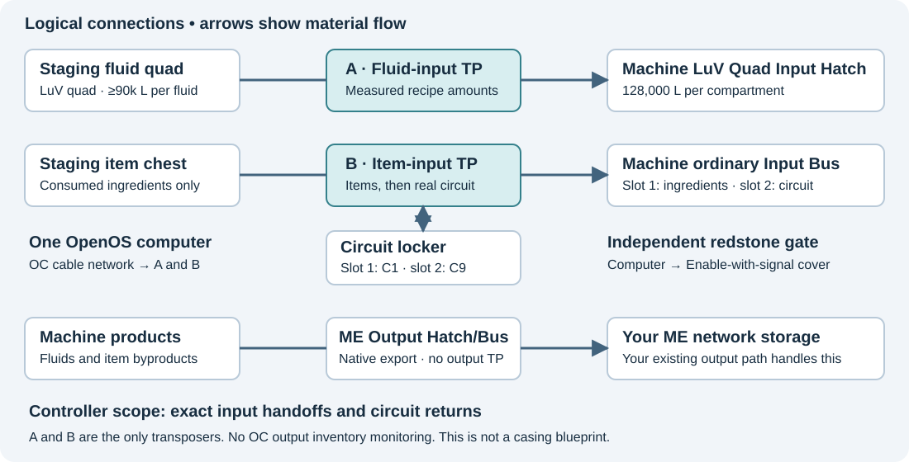

# GTNH Dissolution Tank — OpenComputers controller

Automate all **33 Dissolution Tank recipes** in the checked GTNH 2.9 catalog with exact fluid batches and reusable programmed circuits.

**No ingredient samples required for setup.** Item/fluid identities are prefilled from the loaded GTNH 2.9 registry data. You can use recipes as their ingredients become available; manual binding is an optional override. See [the identity profile](REGISTRY.md).

The default layout uses **two input transposers**. Products export through your normal **ME Output Hatch and ME Output Bus**. The program loads fluids first, verifies their actual amounts, loads consumed items, inserts the circuit last, and enables the machine. After the inputs are consumed it returns the circuit and can prepare the next batch.

**Input acceptance is not production completion.** The controller does not monitor native ME exports. It has passed host-side simulations; live Minecraft commissioning is required.

## Build and installation

Start with the **[full build guide](GUIDE.md)** for parts, capacities, wiring, material bindings, all 33 recipes, commissioning, AE2 staging, and recovery. [GUIDE.html](GUIDE.html) is an offline browser edition; download it to view the rendered document.



### Install over an Internet Card

With OpenOS installed on the HDD and an Internet Card fitted in a Tier 2+ card slot, run:

```sh
wget -f https://raw.githubusercontent.com/dronf/gtnh-dissolution-tank-oc/main/install.lua /tmp/dt-install.lua && lua /tmp/dt-install.lua
```

This installs all six runtime files into `/home/dissolution`. It downloads one pinned, tested revision, verifies file lengths and Lua syntax, and only commits the installation after every download succeeds. It **refuses an existing destination**, so it cannot overwrite your configuration, bindings, or unfinished job. To install another copy, run the downloaded installer with a new directory, for example `lua /tmp/dt-install.lua /home/dissolution-new`.

Then run `cd /home/dissolution`, `lua dt.lua components`, and `edit config.lua`. For transposers directly above the machine hatch/bus, use `stageSide='up'` and `machineSide='down'` in both input entries. Internet access is only needed for downloading; the controller can run after removing the Internet Card. HTTP access must be enabled by the server.

### Hardware and manual installation

1. Build the tank with an IV-capable power supply, a **LuV Quad Input Hatch**, ordinary input bus, native ME outputs, and an independently controlled start gate.
2. Copy `dt.lua`, `dt_core.lua`, `dt_io.lua`, `dt_bindings.lua`, `recipes.lua`, and `config.lua` together to an OpenOS directory such as `/home/dissolution`.
3. Run `lua dt.lua components`. Enter the two transposer UUIDs, redstone UUID, and correct directions in `config.lua`. Keep `outputMode='external'` for native ME export.
4. Run `lua dt.lua materials` to see the prefilled identities (**33 / 33**, no samples or hardware needed). Put the real circuits in their locker and use `lua dt.lua check` for hardware checks. Binding commands are needed only for server-specific overrides.
5. Complete the selected-fluid probe, start-gate checks, and live recipe tests. Set `commissioningPassed=true` only after those checks.
6. Use `lua dt.lua plan` for a staged-lot dry run, then `lua dt.lua run`. Use `resume` to recover an unfinished input transaction after inspection.

The real circuits use an **ordinary bus slot**, not the dedicated circuit/ghost slot that blocks automated movement. The default locker holds exactly one circuit 1 in slot 1 and one circuit 9 in slot 2.

Do not feed machine inputs from another automation system. AE2 delivers complete lots into the separate staging inventories. The program expects exclusive ownership of the actual input hatch and bus.

## Files

| File | Purpose |
|---|---|
| [GUIDE.md](GUIDE.md) | Complete build and operation guide |
| [config.lua](config.lua) | Your addresses, directions, slots, and enable flag |
| [dt.lua](dt.lua) | OpenOS CLI, main loop, transaction journal and recovery |
| [dt_core.lua](dt_core.lua) | Strict recipe recognition and state machine |
| [dt_io.lua](dt_io.lua) | Transposer/redstone driver and fluid-index probe |
| [dt_bindings.lua](dt_bindings.lua) | Prefilled item/fluid identities with local override support |
| [install.lua](install.lua) | Fresh-install Internet Card downloader; preserves existing installations |
| [recipes.lua](recipes.lua) | Runtime catalog: all 33 entries |
| [recipes.csv](recipes.csv) / [recipes.json](recipes.json) | Catalog exports |
| [tests](tests) | Host-side simulations of controller and component behavior |
| [TEST-RESULTS.txt](TEST-RESULTS.txt) | Recorded test output and limitations |

The optional original managed-output mode is described in the guide. It uses two additional transposers and observes/drains a conventional output hatch and bus. Keep the default external mode when ME exports directly.

## Run the simulations

With Python 3.9 or newer:

```sh
python -m pip install -r requirements-dev.txt
python tests/run_tests.py
```

The current suites pass **125,989 simulated assertions**, including all 33 recipes, partial transfers, strict matching, circuit round trips, interrupted transactions, operation without output components, a second batch waiting behind a busy machine, sample-free recognition with the loaded registry identities, installer failures/overwrite protection, and the real CLI's journal writes with OpenOS-style file handles. Installer/journal writes explicitly flush and accept a successful close with no return value; storage failures stop the operation. Components and machine behavior are mocked; real Minecraft persistence, cover polarity, installed recipe changes, and native ME delivery still require live checks.

## Local state

`bindings.dat`, `transaction.dat` and backups, and `controller.lock` are local runtime state and are ignored by Git. Back them up appropriately for your world. Never change configuration or recipe bindings during an unfinished transaction; recovery verifies their signature.

## Catalog provenance

The catalog was checked against GTNH source snapshots and an available archived dump containing 33 unique Dissolution Tank recipes. Primary-source links and version limits are documented in the guide. Compare the reference with NEI on your exact server before use and after pack upgrades.
